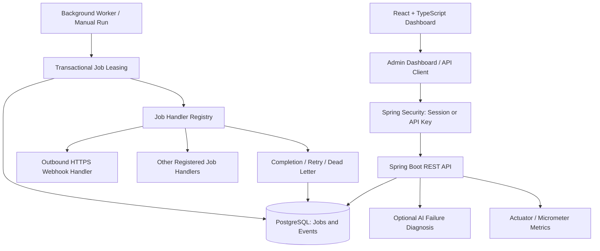
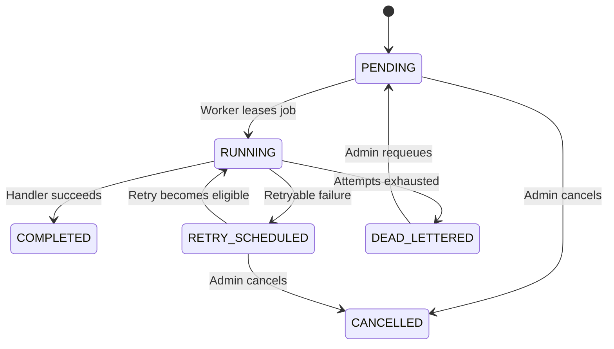

# FlowRelay AI

### Distributed Job Processing, Reliable Webhook Delivery & AI-Assisted Failure Diagnosis

**Java 21 · Spring Boot 3.3 · PostgreSQL 16 · React · TypeScript · Docker · Spring Security · Testcontainers**

[**Live Application**](https://flowrelay-ai-backend.onrender.com/login)· [**Source Code**](https://github.com/mallikarjun-git7/FlowRelay/tree/feature/webhook-delivery) · [**Health Endpoint**](https://flowrelay-ai-backend.onrender.com/actuator/health)

> **Access note:** The deployed dashboard currently requires administrator credentials. Public sign-up and a read-only guest demo are **not implemented**. The public health endpoint is accessible without authentication.

## Overview

**FlowRelay AI** is a database-backed background job processing platform built to explore the challenges behind dependable asynchronous systems: job durability, safe concurrent execution, retries, worker leases, dead-letter handling, operational visibility, and controlled webhook delivery.

The application combines a Spring Boot REST backend, PostgreSQL-based job state and coordination, a React operations dashboard, and an optional AI-assisted diagnosis workflow for failed jobs. A multi-stage Docker build packages the React frontend into the Spring Boot application so they can be served from the same origin.

## System Architecture



**Execution model:** Workers claim eligible jobs using PostgreSQL transactional row-locking (`FOR UPDATE SKIP LOCKED`), execute the selected handler, then persist state changes and job events. Retry scheduling and lease recovery help handle transient errors or interrupted processing.

## Features

| Area | Implemented capabilities |
|---|---|
| Job lifecycle | Submit, inspect, list, schedule, prioritize, retry, cancel, requeue |
| Concurrency | PostgreSQL row-level locks, worker leasing, lease-expiration recovery |
| Failure handling | Configurable retry attempts, retry scheduling, dead-letter states, job event history |
| Webhooks | Outbound HTTPS delivery handler, destination restrictions, timeouts, HTTP error handling |
| Dashboard | Overview, Jobs, Queues, Workers, Dead Letter, Settings |
| Security | Admin login, server-side sessions, API-key authorization, CSRF protection, logout |
| AI integration | Optional failure-diagnosis endpoint with configurable AI provider |
| Observability | Spring Boot Actuator, Micrometer/Prometheus endpoint, Grafana/Prometheus configuration |
| Validation | JUnit, Spring Security tests, PostgreSQL Testcontainers integration tests |
| Deployment | Multi-stage Docker build; React assets served by Spring Boot; Render + Neon PostgreSQL |

### Job state flow



This diagram summarizes the main lifecycle paths; exact transitions are enforced by the application services.

## Technology Stack

| Layer | Technologies |
|---|---|
| Backend | Java 21, Spring Boot 3.3, REST APIs, Gradle |
| Security | Spring Security, BCrypt, session authentication, CSRF tokens, API key |
| Database | PostgreSQL 16, Spring JDBC, Flyway |
| Frontend | React 19, TypeScript, Vite, Tailwind CSS |
| Distributed processing | SQL transactions, `FOR UPDATE SKIP LOCKED`, worker leases |
| AI integration | Optional OpenAI-compatible or Ollama-based diagnosis configuration |
| Testing | JUnit 5, Spring Boot Test, Spring Security Test, Testcontainers |
| Deployment & monitoring | Docker, GitHub Actions, Render, Neon, Actuator, Micrometer, Prometheus, Grafana |

## Running Locally

### Prerequisites

- Java 21 and Docker Desktop
- Git
- Node.js and npm only if developing the React dashboard separately

### Option A — Run the integrated app in Docker

The checked-in Docker Compose file starts PostgreSQL with its development defaults. The commands below launch the application on **port 8081** with **local-only credentials**; they do not change the production deployment.

```bash
git clone https://github.com/mallikarjun-git7/FlowRelay.git
cd FlowRelay
git checkout feature/webhook-delivery

docker compose up -d postgres
docker compose build app

docker compose run --no-deps -d \
  --name flowrelay-local-demo \
  -p 8081:8080 \
  -e FLOWRELAY_REQUIRE_API_KEY=true \
  -e QUEUEFORGE_ADMIN_API_KEY=local-development-key-change-me \
  -e FLOWRELAY_DASHBOARD_USERNAME=admin \
  -e FLOWRELAY_DASHBOARD_PASSWORD=local-development-password-change-me \
  -e QUEUEFORGE_WORKER_ENABLED=false \
  app
```

Open `http://localhost:8081/login` and sign in with the **local credentials supplied above**. The dashboard is available at `http://localhost:8081/` and health at `http://localhost:8081/actuator/health`.

To inspect logs or stop the local app:

```bash
docker logs --tail=100 flowrelay-local-demo
docker stop flowrelay-local-demo
docker rm flowrelay-local-demo
```

> These credentials are for **local development only**. Use unique, strong secrets in any publicly accessible environment. The worker is deliberately disabled in the example; job processing can be triggered through the authorized worker API.

### Option B — Run Spring Boot with a local PostgreSQL container

```bash
docker compose up -d postgres

SPRING_DATASOURCE_URL=jdbc:postgresql://localhost:5433/queueforge \
SPRING_DATASOURCE_USERNAME=queueforge \
SPRING_DATASOURCE_PASSWORD=queueforge_dev_password \
FLOWRELAY_DASHBOARD_USERNAME=admin \
FLOWRELAY_DASHBOARD_PASSWORD=local-development-password-change-me \
QUEUEFORGE_ADMIN_API_KEY=local-development-key-change-me \
./gradlew bootRun
```

The backend serves on `http://localhost:8080`. The Dockerfile is the recommended way to bundle the production frontend with the backend; `cd dashboard && npm ci && npm run dev` is available for separate frontend development.

## Authentication and API Usage

All `/api/**` endpoints require an authenticated administrator session or a valid admin API key. The login page and health endpoint are public. API-key requests use the header `X-QueueForge-Admin-Key`; browser requests use a Spring Security session, and state-changing browser requests require CSRF protection.

**Unauthenticated health check:**

```bash
curl http://localhost:8081/actuator/health
```

**Authenticated list of jobs:**

```bash
export FLOWRELAY_LOCAL_API_KEY='local-development-key-change-me'

curl -H "X-QueueForge-Admin-Key: $FLOWRELAY_LOCAL_API_KEY" \
  http://localhost:8081/api/v1/jobs
```

**Submit a sample job:**

```bash
curl -X POST http://localhost:8081/api/v1/jobs \
  -H "X-QueueForge-Admin-Key: $FLOWRELAY_LOCAL_API_KEY" \
  -H 'Content-Type: application/json' \
  -d '{
    "queue": "default",
    "type": "example.log",
    "payload": {"msg": "Hello from FlowRelay"}
  }'
```

**Selected endpoints**

| Method | Endpoint | Purpose |
|---|---|---|
| `GET` | `/actuator/health` | Public health check |
| `POST` | `/api/v1/jobs` | Submit a job |
| `GET` | `/api/v1/jobs` | List/filter jobs |
| `GET` | `/api/v1/jobs/{id}` | Inspect a job |
| `GET` | `/api/v1/admin/dashboard/summary` | Dashboard totals |
| `GET` | `/api/v1/admin/queues/stats` | Queue statistics |
| `GET` | `/api/v1/admin/workers` | Worker visibility |
| `GET` | `/api/v1/admin/jobs/{id}/events` | Job event timeline |
| `POST` | `/api/v1/admin/jobs/{id}/requeue` | Requeue a job |
| `POST` | `/api/v1/admin/jobs/{id}/cancel` | Cancel a job |
| `POST` | `/api/v1/admin/jobs/{id}/retry-now` | Schedule an immediate retry |
| `POST` | `/api/v1/admin/ai/jobs/{id}/diagnose` | Optional failure diagnosis |

OpenAPI documentation is configured at `/swagger-ui.html`, but access requires authentication.

## Tests and Quality Checks

**Run unit and PostgreSQL integration tests** (Docker Desktop must be running for Testcontainers):

```bash
FLOWRELAY_DASHBOARD_USERNAME=admin \
FLOWRELAY_DASHBOARD_PASSWORD=local-test-password \
./gradlew clean test integrationTest --no-daemon
```

The latest reported local run completed successfully with **43 integration tests**, covering job operations, worker leasing, API-key authorization, session authentication, CSRF and logout.

Build the frontend independently:

```bash
cd dashboard
npm ci
npm run build
```

**CI note:** The repository includes a GitHub Actions workflow; its status should be checked on the [Actions tab](https://github.com/mallikarjun-git7/FlowRelay/actions). Passing local tests does not mean the hosted CI workflow has passed.

## Production Deployment

- **Web application:** [Render](https://flowrelay-ai-backend.onrender.com/)
- **Database:** Neon PostgreSQL
- **Packaging:** Docker multi-stage build (Node frontend build + Java backend build + JRE runtime)
- **Access:** Administrator login; public registration and guest mode are not available

Set the following environment variables in Render. **Never put real values into Git or this README.**

| Variable | Purpose |
|---|---|
| `FLOWRELAY_DASHBOARD_USERNAME` | Admin username |
| `FLOWRELAY_DASHBOARD_PASSWORD` | Strong admin password |
| `QUEUEFORGE_ADMIN_API_KEY` | Private machine-to-machine API key |
| `SPRING_DATASOURCE_URL` | Neon PostgreSQL JDBC URL |
| `SPRING_DATASOURCE_USERNAME` | Database username |
| `SPRING_DATASOURCE_PASSWORD` | Database password |
| `JAVA_TOOL_OPTIONS` | Optional JVM memory settings |
| `FLOWRELAY_REQUIRE_API_KEY` | Legacy compatibility flag; authorization is now enforced by Spring Security |

**Hosting limitation:** Render's free service may spin down during inactivity. An always-on worker or reliable continuous background execution should not be assumed on the free web-service tier. Production data is separate from local Docker test data. Optional AI diagnosis requires a correctly configured and reachable AI provider.

## Engineering Contributions

FlowRelay builds on the MIT-licensed [QueueForge](https://github.com/Thaelith/QueueForge) foundation. Contributions in this repository include:

- Integration of restricted outbound webhook delivery into the existing job handler pipeline.
- Improved database integration tests and concurrent worker test scenarios.
- A unified Docker deployment that bundles the React dashboard with Spring Boot.
- Spring Security-based administrator login, logout, session authorization, API-key access, and CSRF protection.
- Additional API and browser-session security regression tests.
- Operational dashboard fixes, including same-origin API requests and backend health reporting.
- Optional AI-assisted job failure diagnosis integration.

## Roadmap

- [ ] Public, read-only portfolio demo using isolated sample data
- [ ] Additional webhook delivery tests and persistent per-attempt history
- [ ] Improved external side-effect idempotency and failure classification
- [ ] Reproducible throughput/latency benchmarks and load tests
- [ ] Review and fix remaining GitHub Actions CI failures
- [ ] Multi-user registration and per-user data isolation (not currently supported)

## License and Attribution

This project extends [QueueForge by Thaelith](https://github.com/Thaelith/QueueForge), released under the **MIT License**. The original job queue, dashboard and core architecture provide the foundation; FlowRelay's additions are outlined above.

See [LICENSE](LICENSE) for the retained copyright notice and license terms.
